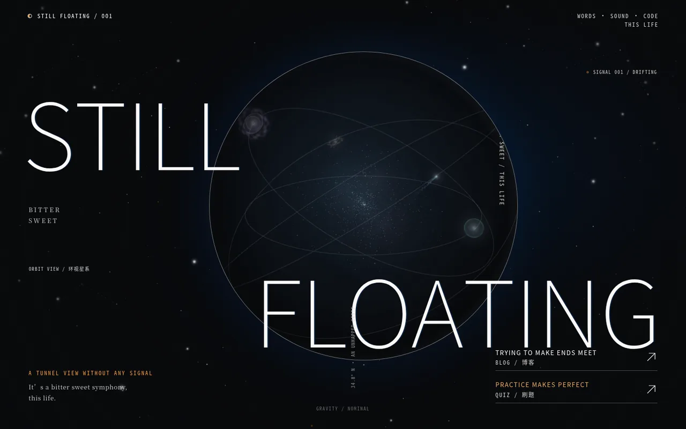
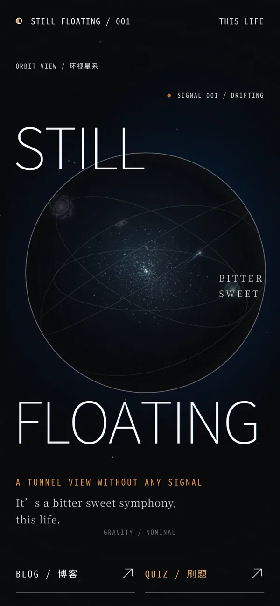

# Still Floating · 博客与 3D 星球入口


> **这是一个 Vibe Coding 项目。** 从想法、文案、视觉到代码，主要由 AI 结对生成，人类负责方向、审美和验收。代码公开存档，供学习、参考和二次创作。
>
> 在线站点：<https://stillfloating.top>



<p align="center"></p>

## 这是什么

`stillfloating.top` 的博客定制代码。站点本体是 WordPress + Argon 主题，本仓库只包含自己写的部分：

- **3D 星球开屏**：首页先展示 Three.js 绘制的星球、星空与星座，底部提供「BLOG / 博客」和「QUIZ / 刷题」两个入口；带 `?sf_blog=1` 或 `?from=portal` 时直接进入正常博客。
- **WordPress 定制插件**：开屏渲染、双入口跳转、跨页日夜渐变过渡，以及博客的「探索 / 文章系列 / 标签 / 音乐馆 / 近况 / 友链 / 片单」等页面增强。
- **构建与部署脚本**：Vite 构建后把资源哈希替换成插件占位符，部署到服务器。

## 目录结构

```
portal-app/                       # 开屏页源码（Vite + Three.js）
├── index.html                    # 页面结构与样式
├── src/main.js                   # 星空、星座、跳转与主题衔接
├── scripts/postprocess.py        # 构建产物后处理（占位符替换）
├── scripts/verify-content.mjs    # 构建产物校验
└── package.json

plugins/                          # WordPress 插件（可直接放进 wp-content/plugins/）
├── still-floating-portal/        # 开屏 + 双入口（含构建好的 portal/ 资源）
├── stillfloating-optimizations/  # 博客功能定制（页面、音乐馆、友链、片单等）
└── still-floating-site-transition/ # 跨页日夜渐变过渡

docs/部署说明.md                   # 线上结构、部署与回滚说明
screenshots/                      # 压缩后的站点截图
```

## 入口逻辑

| 请求 | 行为 |
|---|---|
| `https://stillfloating.top/` | 3D 开屏 |
| `https://stillfloating.top/?sf_blog=1` | 博客首页 |
| `https://stillfloating.top/?from=portal` | 博客首页（带主题衔接参数） |
| `https://quiz.stillfloating.top/` | 刷题站 |
| 文章页 / 搜索 / 分页 / Feed / 后台 | 不显示开屏 |

刷题地址可通过 WordPress 过滤器 `sf_portal_quiz_url` 修改，不必改插件文件。

## 本地构建

```bash
cd portal-app
npm install
npm run build
python3 scripts/postprocess.py   # 生成带 __SF_PORTAL_*__ 占位符的产物
```

## 部署

见 [docs/部署说明.md](docs/部署说明.md)。大致流程：

```bash
PKG=/path/to/wp-content/plugins/still-floating-portal
scp portal-app/dist/index.html        server:$PKG/portal/index.html
scp portal-app/dist/assets/index-*.js server:$PKG/portal/assets/
```

## 技术栈与第三方

- [WordPress](https://wordpress.org/)（GPL）与 [Argon](https://github.com/solstice23/argon-theme) 主题（GPL）——站点基础，未包含在本仓库。
- [Three.js](https://threejs.org/)（MIT）——3D 星空与星球。
- [Vite](https://vite.dev/)（MIT）——构建工具。
- 页面文案中的歌词引用归原作者所有，仅作个人站点展示。

## 许可

代码以 [MIT](LICENSE) 许可开源。第三方库、主题与文案素材遵循各自许可。
